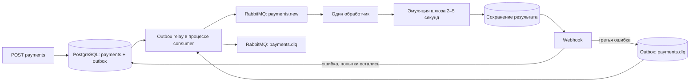

# Асинхронный процессинг платежей

Тестовое задание: FastAPI + Pydantic v2, async SQLAlchemy 2, PostgreSQL,
RabbitMQ/FastStream, Alembic и Docker Compose. Платежи обрабатываются асинхронно;
результат доставляется клиенту через webhook.

## Запуск

Нужны Docker с Compose v2 и Python 3 для генерации локального `.env`:

```sh
python3 scripts/init_env.py
docker compose --profile demo up --build -d
docker compose ps
```

Скрипт создаёт случайные API-ключ и пароли в `.env` с правами `0600`, не выводит
их и не перезаписывает существующий файл. `.env` исключён из Git и Docker-контекста.
В `.env.example` перечислены переменные для ручной настройки. При ручной настройке
пароли в URL должны быть URL-encoded. Порты доступны только на `127.0.0.1`.

Compose поднимает `postgres`, `rabbitmq`, одноразовый `migrate`, `api` и `consumer`.
Профиль `demo` добавляет приёмник webhook. API ждёт завершения миграций; consumer
также ждёт RabbitMQ. Приложение в контейнере работает не от root.

```sh
# Выполнять из корня проекта; ключ не вставляется в исходники.
set -a
. ./.env
set +a

curl -sS http://localhost:8000/health -H "X-API-Key: $API_KEY"
curl -i http://localhost:8000/api/v1/payments \
  -H "X-API-Key: $API_KEY" \
  -H 'Idempotency-Key: order-42' \
  -H 'Content-Type: application/json' \
  -d '{"amount":"1200.50","currency":"RUB","description":"Order 42","metadata":{"order_id":42},"webhook_url":"http://webhook:8080/webhook"}'

curl -sS http://localhost:8000/api/v1/payments/PAYMENT_ID -H "X-API-Key: $API_KEY"
curl -sS http://localhost:8080/events
docker compose logs --tail=100 consumer
```

Первый запрос возвращает `202` с `payment_id`, `status`, `created_at`.
GET возвращает сумму строкой с двумя десятичными знаками, валюту, описание,
метаданные, статус и временные отметки обработки/доставки. Валюты: RUB/USD/EUR.
Сумма положительная, максимум 16 целых и 2 дробных цифры. Лишние поля запрещены.

Повтор с тем же `Idempotency-Key` и эквивалентным телом возвращает тот же платеж
(его текущий статус) и `202`; другое тело с тем же ключом — `409`.
Отсутствующий/неверный API-ключ — `401`, ошибки валидации — `422`, неизвестный ID — `404`.
Ключ идемпотентности обязателен, 1–255 символов без пробельных символов.

Все маршруты API, включая `/health`, `/docs`, `/openapi.json`, защищены `X-API-Key`.
Для Swagger UI нужен клиент/расширение, добавляющее заголовок также к HTML и запросу
схемы; проще импортировать защищённый `/openapi.json` в Postman. Отдельный demo
приёмник не является частью платежного API и предназначен только для локальной проверки.

## Поток обработки и гарантии



* **Transactional outbox.** Платеж и первоначальное событие вставляются в одной
  транзакции. Уникальное ограничение PostgreSQL и `INSERT ... ON CONFLICT` защищают
  от гонок. API не зависит от доступности брокера.
* **Публикация.** Relay выбирает готовое событие через `FOR UPDATE SKIP LOCKED`.
  Сообщение persistent, очереди quorum/durable; включены publisher confirms,
  `mandatory` и ошибка при возврате unroutable-сообщения. `published_at` записывается
  только после подтверждения. При ошибке транзакция откатывается, событие остаётся.
* **At-least-once.** Сбой после подтверждения RabbitMQ, но до commit PostgreSQL
  может создать дубль. Consumer блокирует строку платежа и проверяет сохранённую
  попытку/доставку. У очереди `x-single-active-consumer`, prefetch=1.
* **Шлюз.** Эмуляция занимает 2–5 секунд. Результат определяется случайным UUID
  платежа: примерно 90% succeeded / 10% failed, стабилен при повторе. Результат
  шлюза фиксируется до webhook. При реальной интеграции шлюз должен поддерживать
  идемпотентность по payment_id: одной локальной транзакции для этого недостаточно.
* **Retry.** Всего **3 попытки**, включая первую; задержки перед второй/третьей —
  1 и 2 секунды (`RETRY_BASE_DELAY * 2^(attempt-1)`). Попытка и следующее событие
  фиксируются одной транзакцией. Отложенная доставка реализована через
  `outbox.available_at`, без RabbitMQ-плагинов. Перезапуск не обнуляет попытки.
* **DLQ.** После третьей ошибки создаётся outbox-событие для exchange
  `payments.dead` → `payments.dlq`. Ошибочный JSON/невалидный ID события отклоняется
  сразу через DLX; quorum at-least-once dead-lettering сохраняет его при сбое DLQ.
  DLQ не потребляется автоматически; это очередь для разбора причин оператором.
* **Статусы.** Отказ шлюза — терминальный `failed`, уведомление о нём также
  отправляется. Ошибка webhook не меняет `succeeded` на `failed`. При отсутствии
  известного результата шлюза после технических ошибок статус остаётся `pending`,
  а `delivery_failed_at` и DLQ показывают остановленную обработку.
* **Инфраструктурные сбои.** Недоступность БД/брокера не расходует три бизнес-попытки:
  сообщение возвращается в очередь с задержкой, relay повторяет публикацию.
  Отдельный защитный лимит очереди — 1000 транспортных повторных доставок,
  затем сообщение сохраняется в DLQ. Это не счётчик трёх попыток webhook.

Webhook содержит `event_id`, `payment_id`, `status`, `amount`, `currency`,
`description`, `metadata`, `created_at`, `processed_at`. Заголовки `Idempotency-Key`
и `X-Webhook-Event-ID` содержат стабильное `payment:<uuid>:result`.
Успех — любой 2xx, redirects не выполняются, timeout по умолчанию 5 секунд.
Получатель должен дедуплицировать `event_id`: при сбое между приёмом HTTP и commit
БД уведомление может повториться. Гарантии exactly-once для внешнего HTTP нет.

Для проверки DLQ создайте платеж с `webhook_url=http://webhook:8080/fail`.
RabbitMQ UI: http://localhost:15672 (учётные данные из локального `.env`).

## Тестирование

Полный набор использует настоящие PostgreSQL и RabbitMQ в отдельном Compose-проекте,
без портов хоста и без подключения к рабочей БД:

```sh
docker compose -f compose.test.yaml up --build --abort-on-container-exit --exit-code-from tests
docker compose -f compose.test.yaml down
```

Сквозная проверка запущенного основного Compose (с профилем `demo`):

```sh
docker compose exec -T api python scripts/smoke.py
```

Она отправляет 12 конкурентных HTTP-запросов с одним ключом, проверяет реальную
доставку webhook и наличие сообщения в RabbitMQ DLQ после трёх ошибок приёмника.
Результаты выполненной проверки: [VERIFICATION.md](VERIFICATION.md).

Тестовая PostgreSQL использует tmpfs. Сначала проверяется цикл миграций на пустой
схеме: upgrade → `alembic check` → downgrade → upgrade → `alembic check`, затем pytest.
Доступы в `compose.test.yaml` — фиксированные тестовые значения для
изолированной сети, не рабочие секреты. DB fixtures отказываются очищать базу,
если её имя не заканчивается на `_test`. Не направляйте тестовый RabbitMQ URL на
рабочий брокер: fixtures очищают очереди.

Локальные проверки (Python 3.11+, uv):

```sh
uv sync --frozen
uv run ruff check .
uv run ruff format --check .
uv run pytest -q -m 'not integration and not broker'
python3 scripts/check_secrets.py
```

Для локального полного pytest задайте `TEST_DATABASE_URL`, `TEST_RABBITMQ_URL`,
примените Alembic к тестовой БД и выполните `uv run pytest`. Без этих переменных
интеграционные тесты явно пропускаются. Docker-проверка запускает весь набор.

Проверяются атомарность платежа/outbox, 30 одновременных одинаковых запросов,
20 конфликтующих запросов, блокировки consumer и relay, восстановление после
неуспешной публикации и после подтверждения до commit, broker redelivery,
успех/отказ шлюза, рестарт между шлюзом и webhook, retry, DLQ и poison messages.

## Границы реализации

Это тестовый сервис с эмуляцией оплаты. Для эксплуатации нужны реальный шлюз,
управление секретами/TLS, метрики и алерты, политика хранения outbox и операционная
процедура повторного запуска DLQ. URL webhook принимает авторизованный клиент;
сетевой доступ consumer следует ограничить egress-правилами/allowlist, если
клиенты недоверенные. В локальном demo намеренно разрешены внутренние адреса.
Подпись webhook не предусмотрена исходным ТЗ.

Очередь с одним активным consumer и удержание блокировки строки во время ограниченных
по времени внешних вызовов выбраны для простоты задания. Для высокой пропускной
способности потребуется другая схема конкурентной обработки.

Остановка без удаления данных: `docker compose --profile demo down`.
